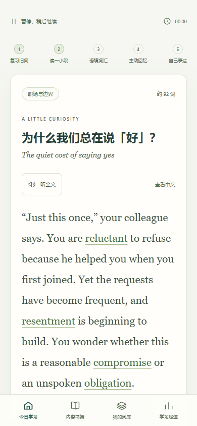

# 夜航英语 · 界面与交互设计

## 产品面向谁

有英语四级基础、工作后时间和精力有限，希望继续积累英语词汇与表达的人。最常见的使用场景是下班后的一小段时间：用户希望应用直接带自己开始，内容值得读、学习量可控、结束后能安心休息。

首版以每天约 8 分钟为标准任务，提供 4 分钟和 1 分钟的降量入口。内容围绕成年人的职场、生活、选择和好奇心展开。

本设计使用 product-designer 技能指导信息架构、视觉层级、双端适配和可用性检查。当前用户需求依据为项目对话，尚未开展正式用户访谈或真实用户可用性研究。

## 界面预览


 

## 信息架构

| 页面 | 用户要做什么 | 主要内容 |
|---|---|---|
| 今日学习 | 点一次开始、继续未完成练习 | 精力选择、今日任务量、内容推荐、词汇状态、最近七天记录 |
| 内容书架 | 选择感兴趣的问题 | 主题插画、内容简介、目标词、预览与加入计划 |
| 我的词库 | 查词、了解状态、开始复习 | 全部 / 已学习 / 到期 / 较稳定筛选，中文或英文搜索，词汇详情 |
| 学习足迹 | 看到真实进步 | 实际投入、学习日、首次回忆正确率、完成记录与个人表达 |
| 学习偏好 | 调整学习节奏 | 精力、提醒时间、日历提醒、安装、备份与重新开始 |

## 视觉风格

暖白底色配深绿操作色，用纸张、书页、窗、月亮和咖啡的插画承载主题。首页强调“今晚这一小步”，阅读与练习页减少额外信息，让注意力落在内容上。

| 设计元素 | 当前规格 |
|---|---|
| 页面背景 | `#F6F7F2` |
| 主要按钮 | `#174E43` |
| 正文 | `#283D35` |
| 主要次要文字 | `#53654D` |
| 卡片 | 暖白、鼠尾草绿、沙色、灰粉、青灰 |
| 中文字体 | 系统无衬线字体，优先可读性 |
| 英文内容字体 | Georgia 衬线字体 |
| 按钮圆角 | 8px |
| 内容卡圆角 | 12–17px |
| 插画 | 本地 SVG，脱网后仍可展示 |

## 电脑与手机如何适配

- **宽屏电脑：** 固定侧栏、主要学习列、辅助信息列。今日计划是视觉中心，辅助列展示问题、词汇和七天记录。
- **平板和窄窗口：** 主列保持完整，辅助信息移至下方；书架卡片适当减少列数。
- **手机：** 单列学习卡、底部四入口导航。主要操作扩大触控区域，内容按学习优先级排列，词汇搭配允许换行。

手机断点为 760px 以下，761–1050px 为窄屏桌面 / 平板布局，1050px 以上展示完整桌面结构。底部导航考虑手机安全区域。

## 核心学习交互

```text
选择精力 → 生成今日任务 → 到期复习
                             ↓
                    阅读语境 → 学词卡
                             ↓
                    隐藏答案主动回忆
                             ↓
                  错词在末尾再出现一次
                             ↓
                  写一句自己的话 → 完成
```

### 开始与结束

首页按钮直接展示本次新词与复习数量。用户不必先选择课程，默认沿用最近的精力与主题。当前主题全部学过后，完成页返回首页会推荐下一个尚有新词的主题。

随时可暂停，学习动作和草稿会保存。刷新后可继续上次的步骤。新计划替换未完成流程前，说明已练习的词仍然保留。

完成页显示实际投入、新词和首次回忆结果，提供明确的返回入口。不要求连续打卡，不制造缺席惩罚。

### 学习反馈

- 看过词卡只记为接触，不直接记为掌握。
- 回忆时先输入，再显示反馈；错误或使用提示的词会较早进入复习。
- 末尾纠正重练不增加首次正确率，也不把词直接标为较稳定。
- 参考表达作为一种可行说法供用户自查，不提供未经实现的自动评分。

### 空状态与错误状态

- 没有学习记录时，词库和足迹展示开始指引，不填充虚构统计。
- 很累模式下没有到期词时，允许安心休息，也可以主动选择其他精力模式。
- 当前主题没有未学词且没有到期复习时，引导更换主题或等待复习。
- 导入备份先校验，再说明替换影响；损坏数据不作为有效进度导入。
- 系统语音不可用时给出说明，文本练习仍可使用。

## 可访问性与验证

页面使用语义化按钮、可见键盘焦点、输入标签和状态播报。练习支持 Enter 提交，弹窗支持 Escape 关闭和 Tab 焦点约束；系统设置减少动画时关闭过渡效果。

主页可见文本经过计算样式对比度抽样检查，调整了小字颜色。手机按钮扩大触控区域，页面在 360、390、430、768、1024、1440px 六种宽度下检查横向溢出。完整学习路径在手机尺寸浏览器中走通。

这些是浏览器验收结果，尚未完成实体 iPhone / Android 和真实用户可用性研究。具体检查范围见 [验收记录](./验收记录.md)，学习规则与后续服务设计见 [实现方案](./实现方案.md)。
